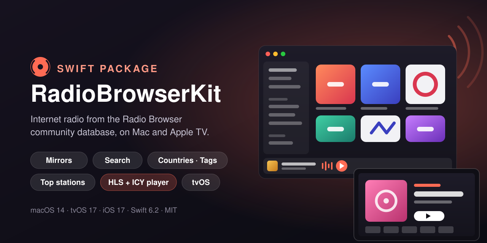
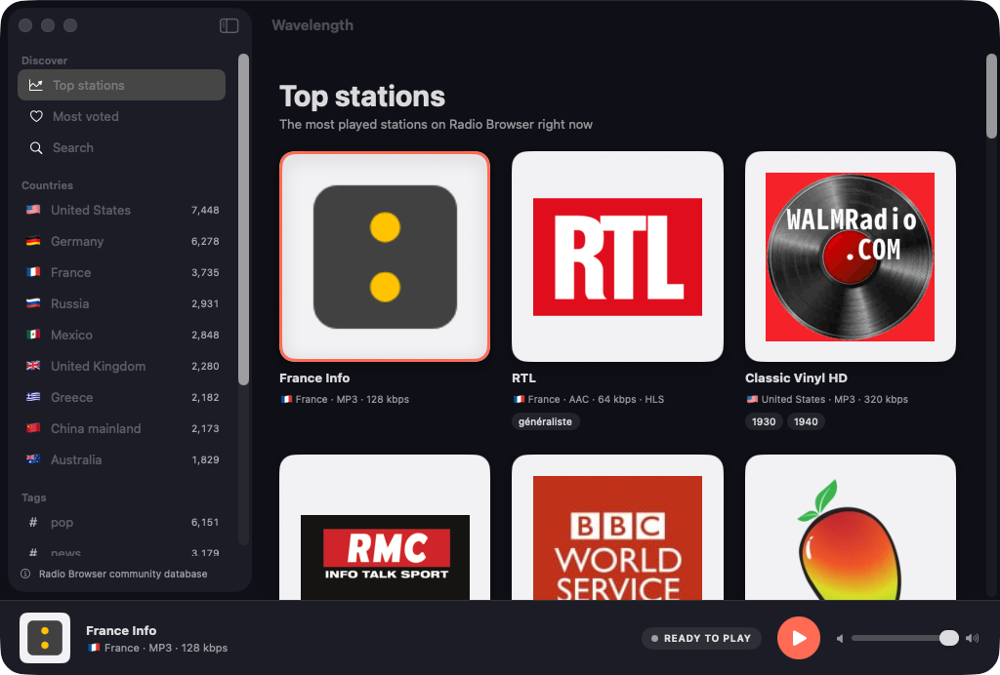
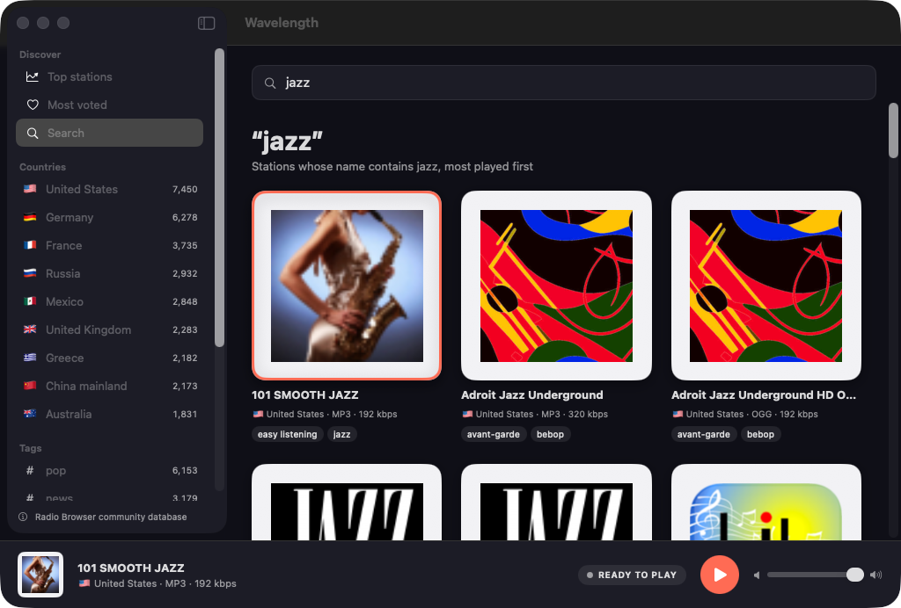
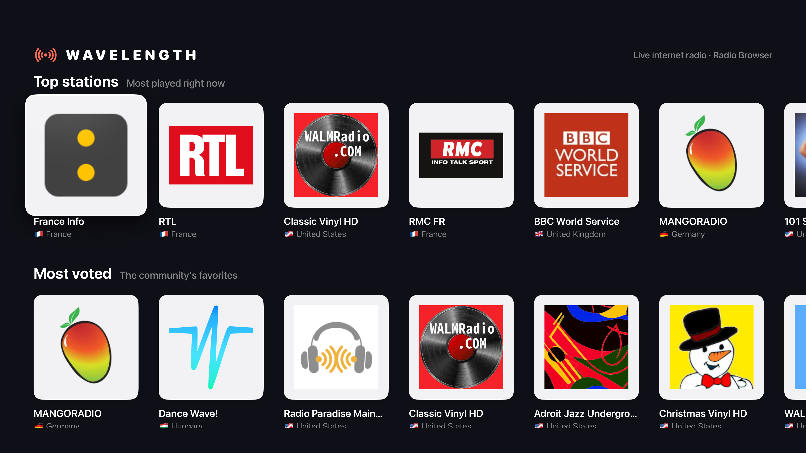
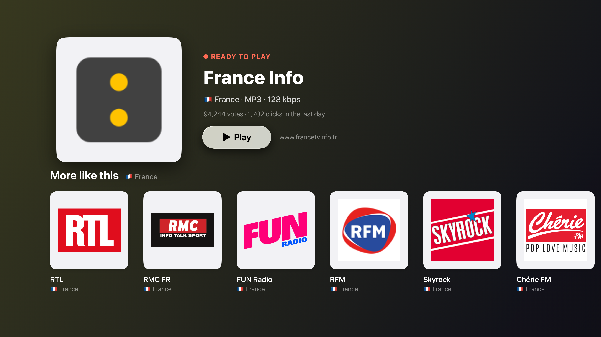

<p align="center">
  
</p>

<p align="center">
  <a href="https://github.com/halilozel1903/RadioBrowserKit/actions/workflows/ci.yml"></a>
  
  
  
  
  
  <a href="LICENSE"></a>
</p>

**RadioBrowserKit** is a Swift client for the [Radio Browser API](https://api.radio-browser.info), the free, community-run database of internet radio stations, with a small `AVPlayer`-based player and an example app for **Mac and Apple TV**. Search tens of thousands of stations by name, country, tag, language, codec and bitrate, list the top clicked and top voted stations, browse countries, tags and languages, count clicks the way Radio Browser asks, and play HLS and plain Icecast or Shoutcast streams with the current song from ICY metadata. No API key, no dependencies.

```swift
import RadioBrowserKit

let radio = RadioBrowserClient()                         // picks a random API mirror

let top = try await radio.topClickedStations(limit: 20)
let jazz = try await radio.searchStations(StationSearch(tag: "jazz", order: .clickCount, reverse: true, limit: 30))
let countries = try await radio.countries()              // most stations first

let player = RadioPlayer()                               // on the main actor
player.play(jazz[0])                                     // counts a click, then plays
player.nowPlaying?.title                                 // from ICY StreamTitle, when sent
```

> **About the data.** Stations come from the community-maintained [Radio Browser](https://www.radio-browser.info) database (radio-browser.info). Anyone can add or edit a station, and every stream is run by a third party: availability, content, logos and metadata are up to each station, not this package. Stations with a failed server check are hidden by default (`hidebroken=true`).

## Screenshots

Captured by CI from the example app, *Wavelength*, with live data from the Radio Browser API: real station names, real favicons, and today's top stations, countries and tags. Many stations have no favicon or a broken one; those get a monogram tile drawn from the station's name. No audio plays during the capture, so the player shows the selected live station ready to play.

| Mac: browse | Mac: search |
| :---: | :---: |
|  |  |

| Apple TV: home | Apple TV: now playing |
| :---: | :---: |
|  |  |

## Features

- **Mirror discovery and failover**: the API has no single host. The client loads the server list from `all.api.radio-browser.info/json/servers`, falls back to `de1`, `de2`, `fi1` and `at1.api.radio-browser.info` when that fails, picks a random mirror, and moves on to the next one when a mirror is down or answers 5xx/429.
- **A descriptive User-Agent** on every request (`RadioBrowserKit/1.0` by default; set your app's own).
- **Station search** with every common filter: name, country code, country, state, language, tag (or several), codec, minimum and maximum bitrate, order, reverse, `hidebroken`, limit and offset.
- **Top lists and the directory**: top clicked and top voted stations, countries, tags and languages with station counts, stations by uuid.
- **Click counting**: `countClick(stationID:)` calls `/json/url/{uuid}`, as Radio Browser asks apps to do when a station starts; `RadioPlayer` does it for you.
- **Typed, forgiving models**: `Station`, `Country`, `StationTag`, `StationLanguage`, `ClickResult`, `ServerMirror`. Numbers or booleans sent as strings, `"null"`, empty URLs, comma-separated tags and languages, and ISO 8601 dates with or without fractions all decode.
- **Favicon handling**: `faviconURL` turns the free-text field into a usable URL (trimmed, protocol-relative and homepage-relative paths fixed, other schemes rejected), `secureFaviconURL` upgrades to https, and `monogram` gives initials and a stable hue for a generated tile.
- **`RadioPlayer`**: an `@Observable` `AVPlayer` wrapper for HLS and plain streams that opens `.pls`, `.m3u`, `.asx` and `.xspf` playlists and reads the current song from ICY `StreamTitle` or HLS timed metadata.
- **Swift 6 strict concurrency**: the client is `Sendable`, the mirror pool is an actor, the player is main-actor isolated. Tested with Swift Testing and recorded fixtures on macOS and on tvOS and iOS simulators.

## API coverage

| Endpoint | Method |
| --- | --- |
| `GET /json/servers` (on `all.api.radio-browser.info`) | `MirrorPool.orderedHosts()`, used by every request |
| `GET /json/stations/search?…` | `searchStations(_: StationSearch)` → `[Station]` |
| | `searchStations(named:limit:hideBroken:)` → `[Station]` |
| `GET /json/stations/topclick?limit=&offset=&hidebroken=` | `topClickedStations(limit:offset:hideBroken:)` → `[Station]` |
| `GET /json/stations/topvote?limit=&offset=&hidebroken=` | `topVotedStations(limit:offset:hideBroken:)` → `[Station]` |
| `GET /json/stations/byuuid?uuids=` | `stations(ids:)` → `[Station]` |
| `GET /json/countries?order=&reverse=&hidebroken=` | `countries(order:reverse:hideBroken:limit:)` → `[Country]` |
| `GET /json/tags?order=&reverse=&hidebroken=&limit=` | `tags(order:reverse:hideBroken:limit:)` → `[StationTag]` |
| `GET /json/languages?order=&reverse=&hidebroken=` | `languages(order:reverse:hideBroken:limit:)` → `[StationLanguage]` |
| `GET /json/url/{stationuuid}` | `countClick(stationID:)` → `ClickResult` |
| anything else | `get(_:query:as:)` decodes any path into your own `Decodable` |

`StationSearch` parameters: `name`, `nameExact`, `countryCode`, `country`, `state`, `language`, `tag`, `tagExact`, `tagList`, `codec`, `bitrateMin`, `bitrateMax`, `order` (`StationOrder`: `.name`, `.votes`, `.clickCount`, `.clickTrend`, `.bitrate`, `.random`…), `reverse`, `hideBroken` (default `true`), `limit` (default 100) and `offset`.

## Installation

In Xcode choose **File › Add Package Dependencies…** and enter:

```
https://github.com/halilozel1903/RadioBrowserKit
```

Or add it to `Package.swift`:

```swift
dependencies: [
    .package(url: "https://github.com/halilozel1903/RadioBrowserKit", from: "1.0.0")
],
targets: [
    .target(name: "MyApp", dependencies: [
        .product(name: "RadioBrowserKit", package: "RadioBrowserKit"),
    ])
]
```

Many streams and favicons are plain `http`. To play or show them, your app needs an App Transport Security exception (`NSAllowsArbitraryLoads`, or per-domain exceptions); the example apps set one. `secureFaviconURL` is there for apps that keep ATS strict.

## Usage

### Search

```swift
let radio = RadioBrowserClient(configuration: RadioBrowserConfiguration(userAgent: "MyRadio/1.0"))

var search = StationSearch()
search.countryCode = "DE"
search.tag = "jazz"
search.bitrateMin = 128
search.order = .clickCount
search.reverse = true          // most played first
search.limit = 40
search.offset = 0              // page with offset

let stations = try await radio.searchStations(search)
for station in stations {
    print(station.name, station.countryFlag ?? "", station.formatDescription ?? "")   // "🇩🇪 MP3 · 128 kbps"
}
```

### Top stations, countries, tags and languages

```swift
let topClicked = try await radio.topClickedStations(limit: 50)
let topVoted = try await radio.topVotedStations(limit: 50)

let countries = try await radio.countries()               // [Country], most stations first
countries[0].name                                         // "The United States Of America"
countries[0].code                                         // "US"
countries[0].flag                                         // "🇺🇸"

let tags = try await radio.tags(limit: 30)                // [StationTag]
let languages = try await radio.languages(order: .name, reverse: false)
```

### Stations

```swift
station.id                // stationuuid
station.streamURL         // url_resolved, else url
station.streamKind        // .hls, .playlist or .direct
station.tags              // ["jazz", "smooth jazz"]
station.languages         // ["german", "english"]
station.votes, station.clickCount, station.clickTrend
station.isBroken          // the last server check failed
station.homepage          // URL?
```

### Favicons

```swift
if let url = station.faviconURL {            // or station.secureFaviconURL
    // load it, and keep a fallback: many favicons are missing, tiny, SVG or not images at all
}
let monogram = station.monogram              // "Radio Paradise" → "RP"
Color(hue: monogram.hue, saturation: 0.55, brightness: 0.6)
```

### Playing

```swift
@State private var player = RadioPlayer()                  // RadioPlayer(client: nil) to never count clicks

Button("Play") { player.play(station) }                    // counts a click, opens playlists, plays
Button("Pause") { player.pause() }
Slider(value: $player.volume)                              // with @Bindable

switch player.state {                                      // .idle, .ready, .connecting, .playing, .paused, .failed
case .playing: Text(player.nowPlaying?.title ?? station.name)
default: EmptyView()
}

player.select(station)                                     // show a station, ready to play, without connecting
```

`NowPlaying(streamTitle:)` parses `Artist - Title` and whole ICY blocks such as `StreamTitle='Artist - Title';`. For background audio on iOS, set your `AVAudioSession` category to `.playback` and enable the audio background mode.

### Mirrors

```swift
await radio.mirrors.orderedHosts()     // ["fi1.api.radio-browser.info", "de2.api…", …], current first

// A fixed server and no discovery, for a self-hosted Radio Browser or a proxy:
let local = RadioBrowserClient(configuration: .server("radio.example.com"))
```

### Errors

```swift
do {
    _ = try await radio.topClickedStations()
} catch let error as RadioBrowserError {
    switch error {
    case .http(let status, let host): break        // after trying other mirrors for 5xx and 429
    case .transport(let urlError): break           // offline or every mirror unreachable
    case .decoding(let type, let description): break
    case .invalidResponse, .noMirrorAvailable, .invalidRequest: break
    }
}
```

### Testing your code

Pass a `URLSession` whose configuration has your `URLProtocol` stub and a fixed host; the package's own tests answer every request from recorded fixtures this way and never touch the network.

```swift
let configuration = URLSessionConfiguration.ephemeral
configuration.protocolClasses = [MyStubProtocol.self]
let client = RadioBrowserClient(configuration: .server("stub.test", session: URLSession(configuration: configuration)))
```

## Example app

`Example/` holds *Wavelength*, built with [XcodeGen](https://github.com/yonaskolb/XcodeGen):

- **Mac** (`WavelengthMac`): a sidebar with Top stations, Most voted, Search, the countries and the tags with the most stations, a grid of stations with their favicons, and a now-playing bar with play/pause and volume.
- **Apple TV** (`WavelengthTV`): rails of top, most voted, jazz, classical and news stations, and a now-playing screen with more stations like the current one.

```bash
brew install xcodegen
cd Example && xcodegen generate && open RadioBrowserDemo.xcodeproj
```

Launch with `-screenshot browse|search|home|nowplaying` to open the scenes CI captures (`scripts/screenshots-mac.sh` and `scripts/screenshots.sh`).

## Requirements

- Swift 6.2 / Xcode 26
- macOS 14, tvOS 17 or iOS 17

## Credits

Station data from the [Radio Browser](https://www.radio-browser.info) community database. Radio Browser is free to use; please send a descriptive User-Agent and count clicks only when a user starts a station. Streams and logos belong to their stations.

## License

RadioBrowserKit is available under the MIT license. See [LICENSE](LICENSE).
